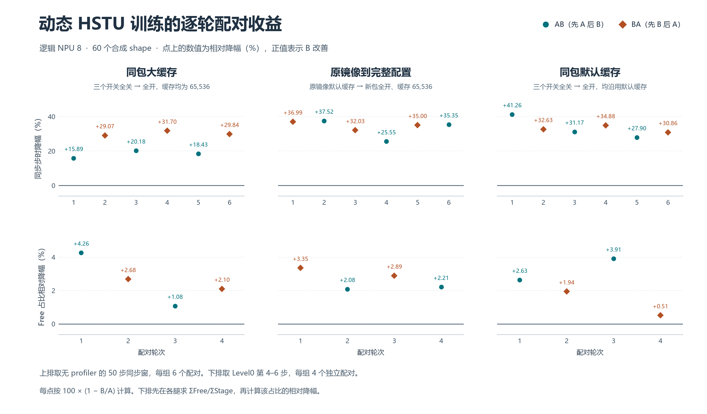

# v2.10 动态 HSTU 分支复测

分支提交 `e3cda6399cb194c813530222478ea018f5aca5c9`，轮次中实际加载的分支原生库 SHA-256 为 `175bd91575354569a63d8599a501b0a19a2a224ada114e44a763ba38fa817d75`。三组分别测量大缓存内的代码开关、原镜像到完整配置的端点变化，以及默认缓存内的代码开关。每组包含 3 个 AB、3 个 BA 的无 profiler 配对，另有 2 个 AB、2 个 BA 的 Level0 配对。

训练沿用动态 eager、1,024 张侧表、单 rank、梯度累积 1、BF16 ZeRO-2、01 分块 overflow 和 Task Queue Mode 1。60 个合成 shape 的 batch size 为 1–4，序列长度为 12–32，每步直接生成实际尺寸。每个无 profiler 窗口预热 10 步、首尾同步测量 50 步，实际计 136 个样本、2,994 个 token。Free 来自 Level0 的第 4–6 步，依次为 [1,19]、[2,14]、[2,22]。

本轮构建含三个补丁。反向与前向分别处理 embedding 的 indices 描述符及缓存复用，Task Queue 补丁改为在满队列有登记等待者时唤醒 producer。[反向 embedding 补丁](https://github.com/j1204150587-svg/pytorch/commit/2cd525d5563cea44fb17596830c3a2367a99dff9) · [前向 embedding 补丁](https://github.com/j1204150587-svg/pytorch/commit/645b89a69c34509e28775b82a5bc478fb33ca556) · [Task Queue 唤醒补丁](https://github.com/j1204150587-svg/pytorch/commit/e3cda6399cb194c813530222478ea018f5aca5c9)

三组端点、重建 wheel 与映射库、默认缓存值及显式 65,536 条目的核对、训练语义和整卡收尾状态均有独立记录。[实验设计](../实验设计.md) · [分支构建](../build/RESULTS.md) · [缓存核对](../build/CACHE_LIMIT.md) · [实际激活与非有限梯度跳步](../semantics/README.md) · [最终占卡状态](../final-slot.json)

|比较|六轮步时降幅中位数 %|六轮步时降幅范围 %|正向轮数|AB / BA 配对降幅中位数 %|Free 占比改善轮数|结论|
|---|---:|---:|---:|---:|---:|---|
|[fixed-cache](../reports/fixed-cache/REPORT.md)|24.626|15.886 / 31.701|6/6|18.433 / 29.844|4/4|步时各轮均改善，Free 占比各轮均改善|
|[stock-to-full](../reports/stock-to-full/REPORT.md)|35.177|25.546 / 37.515|6/6|35.355 / 34.998|4/4|步时各轮均改善，Free 占比各轮均改善|
|[default-cache](../reports/default-cache/REPORT.md)|31.900|27.897 / 41.259|6/6|31.169 / 32.632|4/4|步时各轮均改善，Free 占比各轮均改善|

端到端降幅按同一配对的 A→B 计算。八列中各腿步时取六轮中位数，Free 占比使用该腿 4 个配对共 12 个实测步的 ΣFree/ΣStage。独立 E2E 与 Level0 的聚合分母在各组报告中逐项列出。

### fixed-cache

A 为同一分支包，三项关闭，65,536 项缓存，B 为同一分支包，三项开启，65,536 项缓存。

|优化前端到端|优化后端到端|端到端提升比例|优化前 Free|优化前 Free 占比|优化后 Free|优化后 Free 占比|Free 占比提升比例|
|---:|---:|---:|---:|---:|---:|---:|---:|
|504.213 ms|381.241 ms|24.389%|596.356 ms|91.999%|462.042 ms|89.669%|2.533%|

样本/s 中位数 5.404 → 7.135，token/s 中位数 118.971 → 157.069。每个同步窗口均按真实工作量计数。

四次 Free 占比配对相对降幅为 1.076% 至 4.261%，中位数 2.388%。A/B 的 Stage 为 648.219/515.277 ms/步，Computing 为 51.755/53.135 ms/步。

|步时降幅边界|配对轮次 / 顺序|A→B ms/步|配对降幅|A/B 宿主 1 分钟负载中位数|A/B 全机 CPU 忙碌率|
|---|---|---:|---:|---:|---:|
|最小|`branch-v210-fixed-cache-no-profiler-01-ab` / AB|482.924→406.204|15.886%|28.160 / 32.880|3.919 / 3.711 %|
|最大|`branch-v210-fixed-cache-no-profiler-04-ba` / BA|560.729→382.971|31.701%|32.200 / 24.420|6.186 / 2.959 %|

宿主负载来自与训练进程生命周期重叠的周期采样，包含启动和回收。训练线程所在核心的排队时长没有独立计数。

### stock-to-full

A 为原镜像库、默认缓存，B 为新分支包、三项开启、65,536 项缓存。

|优化前端到端|优化后端到端|端到端提升比例|优化前 Free|优化前 Free 占比|优化后 Free|优化后 Free 占比|Free 占比提升比例|
|---:|---:|---:|---:|---:|---:|---:|---:|
|598.789 ms|383.232 ms|35.999%|620.827 ms|92.316%|477.308 ms|89.836%|2.687%|

样本/s 中位数 4.543 → 7.099，token/s 中位数 100.003 → 156.276。每个同步窗口均按真实工作量计数。

四次 Free 占比配对相对降幅为 2.085% 至 3.349%，中位数 2.547%。A/B 的 Stage 为 672.501/531.311 ms/步，Computing 为 51.556/53.866 ms/步。

|步时降幅边界|配对轮次 / 顺序|A→B ms/步|配对降幅|A/B 宿主 1 分钟负载中位数|A/B 全机 CPU 忙碌率|
|---|---|---:|---:|---:|---:|
|最小|`branch-v210-stock-to-full-no-profiler-04-ab` / AB|604.373→449.979|25.546%|41.975 / 40.490|4.386 / 3.247 %|
|最大|`branch-v210-stock-to-full-no-profiler-02-ab` / AB|624.233→390.049|37.515%|28.220 / 26.950|4.007 / 4.225 %|

宿主负载来自与训练进程生命周期重叠的周期采样，包含启动和回收。训练线程所在核心的排队时长没有独立计数。

### default-cache

A 为同一分支包，三项关闭，默认缓存，B 为同一分支包，三项开启，默认缓存。

|优化前端到端|优化后端到端|端到端提升比例|优化前 Free|优化前 Free 占比|优化后 Free|优化后 Free 占比|Free 占比提升比例|
|---:|---:|---:|---:|---:|---:|---:|---:|
|592.124 ms|400.723 ms|32.324%|615.163 ms|92.243%|493.939 ms|90.197%|2.218%|

样本/s 中位数 4.594 → 6.788，token/s 中位数 101.131 → 149.430。每个同步窗口均按真实工作量计数。

四次 Free 占比配对相对降幅为 0.507% 至 3.907%，中位数 2.285%。A/B 的 Stage 为 666.897/547.625 ms/步，Computing 为 51.617/53.558 ms/步。

|步时降幅边界|配对轮次 / 顺序|A→B ms/步|配对降幅|A/B 宿主 1 分钟负载中位数|A/B 全机 CPU 忙碌率|
|---|---|---:|---:|---:|---:|
|最小|`branch-v210-default-cache-no-profiler-05-ab` / AB|588.586→424.387|27.897%|29.335 / 28.870|4.223 / 3.098 %|
|最大|`branch-v210-default-cache-no-profiler-01-ab` / AB|636.225→373.727|41.259%|31.490 / 36.630|3.795 / 3.719 %|

宿主负载来自与训练进程生命周期重叠的周期采样，包含启动和回收。训练线程所在核心的排队时长没有独立计数。

## 首见形状的 Level1 对照

|比较 / 步|实际 shape|实际工作 A→B|已关联队列请求 A→B|队列请求的计数差|同线程 ATen 顺序相同|相同物理流与任务序列|ACL 调用数相同|
|---|---|---:|---:|---|---|---|---|
|fixed-cache / 4|[1, 19]|17220→17220|9922→9928|`Enqueue@destroy_event` 5→11|是|否|是|
|fixed-cache / 5|[2, 14]|17221→17221|9929→9923|`Enqueue@destroy_event` 11→5|是|否|是|
|default-cache / 4|[1, 19]|17220→17220|9922→9928|`Enqueue@destroy_event` 5→11|是|否|是|
|default-cache / 5|[2, 14]|17221→17221|9929→9923|`Enqueue@destroy_event` 11→5|是|否|是|

两种缓存配置都观察到每步 17,220 或 17,221 项实际设备工作，A/B 各类 ACL 提交数相等。嵌入前反向的 Host 参数准备和 consumer 服务时长下降。每步每个目标算子共有 1,027 个按序号对齐的请求，其中 1,024 个改变了具体设备任务名，流与任务数一致。这组整包配对支持 Host 请求缩短并伴随 kernel 替换，无法将整包步时收益分配给单个补丁，也无法把全部变化归给单次同名 ACL launch。

两个 Level1 录制只覆盖首见形状 [1,19]、[2,14]。60 个合成形状各出现一次，本组没有同一实际 shape 再次执行的对照。首张与同一步其余 1,023 张侧表按顺序、物理流以及实际 dtype 和输入 shape 单列。[首张及后续侧表逐请求归因](../reports/side-tables.md) · [未舍入数据](../reports/side-tables.json)

### fixed-cache 的嵌入前反向

具体函数为 `aclnnEmbedding`、`aclnnEmbeddingDenseBackward`。

|步|算子|腿|producer 准备|workspace|有符号队列等待|consumer 服务|每请求 ACL 合计|队列等待 >100 µs 次数|
|---:|---|---|---:|---:|---:|---:|---:|---:|
|4|aclnnEmbedding|A|40.21 / 66.91 (1027)|22.19 / 36.98 (1026)|2.27 / 2.87 (1027)|46.79 / 62.67 (1027)|11.18 / 16.53 (1027)|0|
|4|aclnnEmbedding|B|12.38 / 36.69 (1027)|17.06 / 17.91 (18)|2.08 / 2.76 (1027)|16.49 / 46.86 (1027)|11.01 / 15.90 (1027)|0|
|4|aclnnEmbeddingDenseBackward|A|69.48 / 115.96 (1027)|48.69 / 86.70 (1026)|2.31 / 3.15 (1027)|123.28 / 159.18 (1027)|31.54 / 39.14 (1027)|0|
|4|aclnnEmbeddingDenseBackward|B|14.71 / 66.71 (1027)|42.98 / 55.80 (18)|2.61 / 3.43 (1027)|36.69 / 122.76 (1027)|24.89 / 35.32 (1027)|0|
|5|aclnnEmbedding|A|41.09 / 69.00 (1027)|22.43 / 36.65 (1026)|2.22 / 2.77 (1027)|47.41 / 65.04 (1027)|11.24 / 12.93 (1027)|0|
|5|aclnnEmbedding|B|12.97 / 38.53 (1027)|17.90 / 23.34 (18)|2.78 / 3.51 (1027)|16.93 / 48.45 (1027)|10.91 / 14.10 (1027)|0|
|5|aclnnEmbeddingDenseBackward|A|71.75 / 119.59 (1027)|50.14 / 85.80 (1026)|2.21 / 2.85 (1027)|120.05 / 148.75 (1027)|31.38 / 40.04 (1027)|0|
|5|aclnnEmbeddingDenseBackward|B|15.72 / 67.40 (1027)|43.47 / 73.09 (18)|2.67 / 3.35 (1027)|37.22 / 124.31 (1027)|25.33 / 34.32 (1027)|0|

各格为 p50 / p99（样本数），单位 µs。producer 准备从已对齐的 ATen 起点算至 enqueue 开始，通常包含 workspace。workspace 计数仅覆盖具有对应打点的请求。consumer 服务包含 ACL，每请求 ACL 合计可覆盖多次 API。

|步|算子|共同请求|双腿有设备连线|同流且任务数一致|同流、类型、名称、顺序均一致|每请求汇总的 ACL 调用数 A→B|设备工作减少|设备工作增加|
|---:|---|---:|---:|---:|---:|---:|---|---|
|4|aclnnEmbedding|1027|1027|1027|3|2051→2051|`aclnnEmbedding_SliceAiCore_Slice` ×1024 (流 47)|`aclnnEmbedding_AsStridedAiCore_AsStrided` ×1024 (流 47)|
|4|aclnnEmbeddingDenseBackward|1027|1027|1027|3|6159→6159|`aclnnEmbeddingDenseBackward_SliceAiCore_Slice` ×1024 (流 47)|`aclnnEmbeddingDenseBackward_AsStridedAiCore_AsStrided` ×1024 (流 47)|
|5|aclnnEmbedding|1027|1027|1027|3|2051→2051|`aclnnEmbedding_SliceAiCore_Slice` ×1024 (流 47)|`aclnnEmbedding_AsStridedAiCore_AsStrided` ×1024 (流 47)|
|5|aclnnEmbeddingDenseBackward|1027|1027|1027|3|6159→6159|`aclnnEmbeddingDenseBackward_SliceAiCore_Slice` ×1024 (流 47)|`aclnnEmbeddingDenseBackward_AsStridedAiCore_AsStrided` ×1024 (流 47)|

设备工作按物理流和任务名分别计数。对齐键为调用线程角色、ATen 名称和该线程内序号。相同提交数可包含 kernel 名称替换。

|步|算子|腿|前邻设备空档总 ms|workspace 相交 ms|可见队列等待相交 ms|consumer 至 API 相交 ms|ACL 提交相交 ms|API 后相交 ms|
|---:|---|---|---:|---:|---:|---:|---:|---:|
|4|aclnnEmbedding|A|86.694|15.898|2.371|13.777|8.711|33.209|
|4|aclnnEmbedding|B|47.891|0.268|2.215|2.814|8.759|11.358|
|4|aclnnEmbeddingDenseBackward|A|175.318|46.025|2.452|17.902|7.457|88.361|
|4|aclnnEmbeddingDenseBackward|B|46.185|0.784|2.600|3.431|5.157|30.297|
|5|aclnnEmbedding|A|88.121|5.630|2.180|12.940|6.279|51.706|
|5|aclnnEmbedding|B|53.546|0.299|2.841|3.048|7.986|24.717|
|5|aclnnEmbeddingDenseBackward|A|177.104|32.672|2.306|16.729|5.222|107.599|
|5|aclnnEmbeddingDenseBackward|B|52.884|0.731|0.633|0.986|2.470|45.305|

按下一项设备工作所属请求归集前邻空档，上表列出重点区间，全部阶段及每个空档的时间戳见 linked CSV。相交时长用于定位暴露开销，无法单凭交叠判定因果。

### default-cache 的嵌入前反向

具体函数为 `aclnnEmbedding`、`aclnnEmbeddingDenseBackward`。

|步|算子|腿|producer 准备|workspace|有符号队列等待|consumer 服务|每请求 ACL 合计|队列等待 >100 µs 次数|
|---:|---|---|---:|---:|---:|---:|---:|---:|
|4|aclnnEmbedding|A|37.87 / 64.83 (1027)|20.20 / 37.84 (1026)|1.60 / 2.13 (1027)|45.07 / 68.66 (1027)|11.13 / 21.37 (1027)|0|
|4|aclnnEmbedding|B|13.07 / 38.30 (1027)|17.64 / 18.88 (18)|2.58 / 2.91 (1027)|16.39 / 47.00 (1027)|10.67 / 16.22 (1027)|0|
|4|aclnnEmbeddingDenseBackward|A|68.36 / 126.05 (1027)|47.80 / 93.45 (1026)|2.14 / 4.89 (1027)|122.23 / 170.27 (1027)|32.19 / 46.49 (1027)|0|
|4|aclnnEmbeddingDenseBackward|B|14.68 / 66.39 (1027)|43.02 / 55.77 (18)|2.67 / 3.05 (1027)|37.45 / 125.22 (1027)|25.59 / 34.75 (1027)|0|
|5|aclnnEmbedding|A|38.27 / 62.66 (1027)|20.46 / 35.07 (1026)|1.59 / 2.14 (1027)|44.62 / 64.20 (1027)|11.22 / 12.44 (1027)|0|
|5|aclnnEmbedding|B|12.92 / 37.90 (1027)|17.68 / 20.61 (18)|2.45 / 2.87 (1027)|16.40 / 46.32 (1027)|10.72 / 14.11 (1027)|0|
|5|aclnnEmbeddingDenseBackward|A|68.20 / 134.10 (1027)|47.79 / 99.44 (1026)|2.10 / 2.59 (1027)|120.77 / 174.30 (1027)|31.60 / 46.04 (1027)|0|
|5|aclnnEmbeddingDenseBackward|B|14.65 / 66.23 (1027)|43.06 / 57.45 (18)|2.59 / 2.98 (1027)|37.08 / 123.73 (1027)|25.16 / 33.83 (1027)|0|

各格为 p50 / p99（样本数），单位 µs。producer 准备从已对齐的 ATen 起点算至 enqueue 开始，通常包含 workspace。workspace 计数仅覆盖具有对应打点的请求。consumer 服务包含 ACL，每请求 ACL 合计可覆盖多次 API。

|步|算子|共同请求|双腿有设备连线|同流且任务数一致|同流、类型、名称、顺序均一致|每请求汇总的 ACL 调用数 A→B|设备工作减少|设备工作增加|
|---:|---|---:|---:|---:|---:|---:|---|---|
|4|aclnnEmbedding|1027|1027|1027|3|2051→2051|`aclnnEmbedding_SliceAiCore_Slice` ×1024 (流 47)|`aclnnEmbedding_AsStridedAiCore_AsStrided` ×1024 (流 47)|
|4|aclnnEmbeddingDenseBackward|1027|1027|1027|3|6159→6159|`aclnnEmbeddingDenseBackward_SliceAiCore_Slice` ×1024 (流 47)|`aclnnEmbeddingDenseBackward_AsStridedAiCore_AsStrided` ×1024 (流 47)|
|5|aclnnEmbedding|1027|1027|1027|3|2051→2051|`aclnnEmbedding_SliceAiCore_Slice` ×1024 (流 47)|`aclnnEmbedding_AsStridedAiCore_AsStrided` ×1024 (流 47)|
|5|aclnnEmbeddingDenseBackward|1027|1027|1027|3|6159→6159|`aclnnEmbeddingDenseBackward_SliceAiCore_Slice` ×1024 (流 47)|`aclnnEmbeddingDenseBackward_AsStridedAiCore_AsStrided` ×1024 (流 47)|

设备工作按物理流和任务名分别计数。对齐键为调用线程角色、ATen 名称和该线程内序号。相同提交数可包含 kernel 名称替换。

|步|算子|腿|前邻设备空档总 ms|workspace 相交 ms|可见队列等待相交 ms|consumer 至 API 相交 ms|ACL 提交相交 ms|API 后相交 ms|
|---:|---|---|---:|---:|---:|---:|---:|---:|
|4|aclnnEmbedding|A|85.630|19.059|1.647|13.892|10.993|24.293|
|4|aclnnEmbedding|B|48.684|0.274|2.589|3.041|8.128|12.787|
|4|aclnnEmbeddingDenseBackward|A|174.353|51.277|2.242|17.899|11.571|77.686|
|4|aclnnEmbeddingDenseBackward|B|50.958|0.800|2.514|3.476|5.036|33.469|
|5|aclnnEmbedding|A|84.549|7.315|1.583|11.617|6.199|48.171|
|5|aclnnEmbedding|B|49.009|0.175|2.362|2.920|7.807|26.237|
|5|aclnnEmbeddingDenseBackward|A|175.562|34.516|2.129|16.622|5.115|104.777|
|5|aclnnEmbeddingDenseBackward|B|50.232|0.613|0.261|0.711|2.246|46.001|

按下一项设备工作所属请求归集前邻空档，上表列出重点区间，全部阶段及每个空档的时间戳见 linked CSV。相交时长用于定位暴露开销，无法单凭交叠判定因果。

每次实际请求的 producer、队列等待、consumer、ACL 调用分位数和对应设备空档，都可在各组 REPORT 以及逐笔 linked CSV 中核对。物理任务序列和启动 API 未对齐时，不能据此声称单次提交提速。

35 个配对的 70 条腿逐一核对卡映射、两端无残留、真实 PID 与整卡采样。每腿采样 4–14 次，均见到目标 worker，异常/外部进程快照为 0。共享宿主负载随时间变化；本表记录轮次波动，不给出未经配对验证的固定收益。

三种配置的八步训练审计均通过。原始结果中 norm 差最大为 0，loss 最大绝对差为 7.62939e-06，各腿梯度、训练权重及 AdamW 状态通过原审计。

大缓存配置的八步审计中，B 前向命中 8,192 次、回退 24 次，反向命中 8,192 次、回退 24 次。两腿消费队列项为 87,845 / 87,845，未观察到登记 producer 等待者时的 eventfd 写由 87,066 次降至 0 次。独立 ZeRO-2 探针覆盖 4 次有限更新和 3 次非有限梯度跳步，A/B 的梯度、权重、AdamW 状态逐步一致。[实际计数和微门收据](../semantics/activation.json)

每个配对的源目录、原 trace 路径、文件大小及 SHA-256 在证据索引中。正式采样期间的全机负载快照、worker 映射、原始命令、shape 和分支审计收据收录于原始包。[逐配对源与 trace 哈希](../data/evidence-index.json) · [各腿卡况](../data/occupancy.json) · [八步审计](../data/audits.json) · [原始收据与轨道](原始收据与轨道.tgz) · [汇总与复算程序](汇总与复算程序.tgz)
